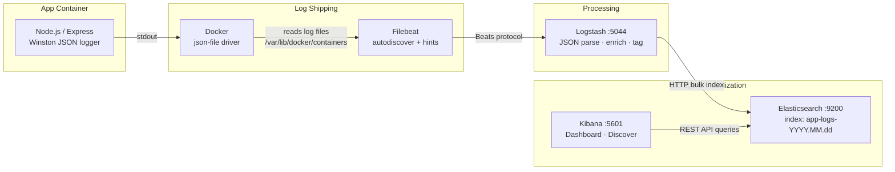

# Centralized Container Logging and Visualization Using ELK Stack

[](https://github.com/an0ushkaaa/devops-lab-ca/actions/workflows/ci-cd.yml)

A Node.js Express REST API whose structured JSON logs are automatically collected by Filebeat, enriched by Logstash, stored in Elasticsearch, and visualized in Kibana. The entire stack runs in Docker Compose and is deployed through a GitHub Actions CI/CD pipeline.

---

## Architecture



**Data flow in plain text:**

```
Express app (stdout JSON)
  └─▶ Docker json-file driver  (/var/lib/docker/containers/<id>/<id>-json.log)
        └─▶ Filebeat  (Docker autodiscover, co.elastic.logs/* hint labels)
              └─▶ Logstash :5044  (JSON decode → promote fields → tag errors)
                    └─▶ Elasticsearch  (index: app-logs-YYYY.MM.dd)
                              ▲
                         Kibana :5601
```

---

## Prerequisites

| Tool | Minimum version | Purpose |
|---|---|---|
| Docker Desktop | 24.x | Container runtime |
| Docker Compose | v2.x (`docker compose`) | Multi-service orchestration |
| Node.js | 18.x | Local development and testing |
| Python 3 | 3.8+ | `setup-kibana.sh` JSON escaping helper |
| curl | any | `setup-kibana.sh` HTTP calls |
| Git | any | Clone and CI/CD |

> **Memory:** Elasticsearch requires at least **4 GB RAM** allocated to Docker Desktop (`Settings → Resources`).

---

## Folder structure

```
.
├── .github/
│   └── workflows/
│       └── ci-cd.yml           # GitHub Actions: test → build → deploy
├── filebeat/
│   └── filebeat.yml            # Docker autodiscover, Beats output to Logstash
├── logstash/
│   └── pipeline/
│       └── logstash.conf       # Beats input → JSON filter → Elasticsearch output
├── src/
│   ├── app.js                  # Express app: routes, request logger, error handler
│   ├── logger.js               # Winston: JSON format, console + file transports
│   └── routes/
│       └── products.js         # GET /products, POST /products
├── tests/
│   └── app.test.js             # Jest + Supertest, 10 tests across all 4 endpoints
├── .dockerignore
├── .gitignore
├── docker-compose.yml          # Full stack: app + Elasticsearch + Logstash + Kibana + Filebeat
├── Dockerfile                  # Multi-stage: deps → test → production (node:18-alpine)
├── package.json
└── setup-kibana.sh             # Provisions Kibana data view, 3 visualizations, dashboard
```

---

## Setup

### 1. Clone

```bash
git clone https://github.com/<YOUR_GITHUB_USERNAME>/<YOUR_REPO_NAME>.git
cd <YOUR_REPO_NAME>
```

### 2. Start the stack

```bash
docker compose up --build -d
```

This starts five services in dependency order:

```
elasticsearch (healthy) ──▶ logstash (healthy) ──▶ filebeat
elasticsearch (healthy) ──▶ kibana
elasticsearch (healthy) ──▶ app
```

Cold start takes **2–3 minutes** on first run (image pulls + Elasticsearch initialisation).

### 3. Verify all services are healthy

```bash
docker compose ps
```

Expected output — all five services should show `healthy` or `running`:

```
NAME                      STATUS
devops-lab-ca-app         running (healthy)
devops-lab-ca-es          running (healthy)
devops-lab-ca-kibana      running (healthy)
devops-lab-ca-logstash    running (healthy)
devops-lab-ca-filebeat    running
```

### 4. Provision Kibana

Run once after the stack is up. The script waits for Kibana automatically, then creates the data view, visualizations, and dashboard.

```bash
chmod +x setup-kibana.sh
./setup-kibana.sh
```

The script is fully idempotent — re-running it overwrites objects in place without creating duplicates.

### 5. Generate log data

```bash
# Liveness check (info-level log)
curl http://localhost:3000/health

# List products (info-level log)
curl http://localhost:3000/products

# Create a product (info-level log, 201)
curl -X POST http://localhost:3000/products \
     -H "Content-Type: application/json" \
     -d '{"name": "Widget A", "price": 9.99}'

# Trigger an intentional error (error-level log with stack trace, 500)
curl http://localhost:3000/error
```

---

## API endpoints

| Method | Path | Description | Status |
|---|---|---|---|
| `GET` | `/health` | Liveness probe, returns uptime | 200 |
| `GET` | `/products` | List all products | 200 |
| `POST` | `/products` | Create a product `{ name, price }` | 201 |
| `GET` | `/error` | Intentional 500, exercises error logging | 500 |

Every request emits a structured JSON log with `timestamp`, `method`, `route`, `statusCode`, and `responseTimeMs`. Error events additionally include the full `stack` trace.

---

## Running tests

Tests run against the Express app directly (no Docker required).

```bash
# Install dependencies
npm install

# Run the Jest suite (10 tests)
npm test
```

Expected output:

```
PASS tests/app.test.js
  GET /health       ✓ returns 200 with status ok
  GET /products     ✓ returns 200 with a products array
                    ✓ each product has id, name, and price
  POST /products    ✓ creates a product and returns 201
                    ✓ returns 400 when name is missing
                    ✓ returns 400 when price is missing
                    ✓ returns 400 when price is negative
                    ✓ new product appears in GET /products
  GET /error        ✓ returns 500 with an error message
                    ✓ error message is not empty

Tests: 10 passed, 10 total
```

---

## Kibana dashboard

Open **http://localhost:5601** in a browser after running `setup-kibana.sh`.

### Direct dashboard link

```
http://localhost:5601/app/dashboards#/view/app-monitoring-dashboard
```

### What you will see

The **App Monitoring** dashboard contains three panels:

| Panel | Type | What it shows |
|---|---|---|
| Request Count by HTTP Status Code | Stacked bar | Request volume over time, split by 2xx / 4xx / 5xx |
| P95 Response Time (ms) | Line chart | 95th-percentile latency from `response_time_ms` |
| Top 10 Error Messages | Data table | Most frequent `error`-level log messages and their occurrence count |

The default time range is **last 1 hour**, auto-refreshing every **30 seconds**.

### Explore raw logs

1. Go to **Discover** → select the `App Logs (devops-lab-ca)` data view.
2. Key fields to filter on:

| Field | Example values |
|---|---|
| `log_level` | `info`, `warn`, `error` |
| `http_route` | `/health`, `/products`, `/error` |
| `http_status_code` | `200`, `201`, `400`, `500` |
| `response_time_ms` | float, ms |
| `log_message` | human-readable log text |

### Verify Elasticsearch indexing

```bash
# Cluster health
curl http://localhost:9200/_cluster/health?pretty

# List daily indices
curl http://localhost:9200/_cat/indices/app-logs-*?v&s=index

# Sample the latest 3 documents
curl "http://localhost:9200/app-logs-*/_search?size=3&sort=@timestamp:desc&pretty"
```

---

## CI/CD pipeline

**File:** `.github/workflows/ci-cd.yml`  
**Triggers:** push to `main`, pull requests targeting `main`

```
push / PR
    │
    ▼
┌──────────┐   needs   ┌──────────────────────┐   needs   ┌─────────────────────────┐
│  test    │ ────────▶ │       build          │ ────────▶ │        deploy           │
│          │           │                      │           │                         │
│ node:18  │           │ docker buildx        │           │ PR  → compose config    │
│ npm ci   │           │ tags: sha, main,     │           │      validation only    │
│ npm test │           │       latest         │           │                         │
│ audit    │           │ push to GHCR (main)  │           │ main → SSH pull +       │
└──────────┘           └──────────────────────┘           │      compose up -d app  │
                                                          └─────────────────────────┘
```

### Job details

**`test`**  
Runs inside a `node:18-alpine` container. Caches `node_modules` keyed on `package-lock.json` hash — a cache hit skips `npm ci` entirely. Also runs `npm audit --audit-level=high` (advisory, non-blocking).

**`build`**  
Uses Docker Buildx with `type=gha,mode=max` layer caching (all three Dockerfile stages cached). The Dockerfile's own `test` stage re-runs Jest inside the image build as a second gate. Image is pushed to GHCR only on merges to `main`; PR builds are local smoke-tests.

**`deploy`**  
- **Pull requests:** `docker compose config --quiet` — validates YAML syntax and service references, no server access needed.  
- **Push to main:** SSH to server → `docker pull` → `docker tag` → `docker compose up -d --no-deps --force-recreate app` → healthcheck wait → `/health` smoke test. The ELK stack is left running; only the app container is cycled.

### Required secrets

Configure at **Settings → Secrets and variables → Actions**:

| Secret | Required for | Description |
|---|---|---|
| `DEPLOY_HOST` | main deploy | SSH hostname or IP |
| `DEPLOY_USER` | main deploy | SSH login user |
| `DEPLOY_SSH_KEY` | main deploy | Private key (PEM, no passphrase) |
| `DEPLOY_WORK_DIR` | main deploy | Absolute path to project root on server |
| `GITHUB_TOKEN` | image push | Auto-injected, no configuration needed |

> Pull request runs require **none** of the `DEPLOY_*` secrets.

---

## Useful commands

```bash
# Follow logs from all services
docker compose logs -f

# Follow only the app
docker compose logs -f app

# Inspect container health
docker inspect --format='{{.State.Health.Status}}' devops-lab-ca-app

# Logstash pipeline metrics
curl http://localhost:9600/?pretty

# Stop the stack (keeps Elasticsearch data)
docker compose down

# Full teardown including all volumes
docker compose down -v
```

---

## Environment variables

| Variable | Default | Description |
|---|---|---|
| `PORT` | `3000` | Express listen port |
| `NODE_ENV` | `production` | Node environment |
| `KIBANA_URL` | `http://localhost:5601` | Target for `setup-kibana.sh` |
| `MAX_WAIT` | `300` | Seconds `setup-kibana.sh` waits for Kibana |
| `RETRY_INTERVAL` | `5` | Poll interval in `setup-kibana.sh` |
